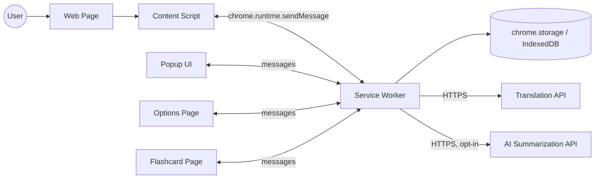
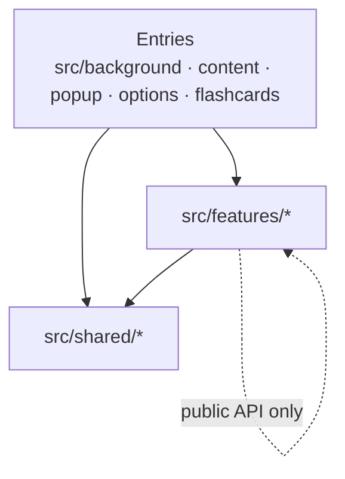

# ARCHITECTURE

> **Audience:** developers (new members + AI coding assistants). Read this file **before** writing any code.
> **Status:** v1.1. Code is organized **feature-based** (see §6–7). Items marked `⚠️ VERIFY` were inferred and must be confirmed against the codebase.
> **Related docs:** [PROJECT-RULES.md](./PROJECT-RULES.md) · [DATA-SCHEMA.md](./DATA-SCHEMA.md) · [API-CONTRACTS.md](./API-CONTRACTS.md) · [PRD.md](./PRD.md)

---

## 1. Overview

**English Reading Assistant** is a Chrome extension (Manifest V3) that:
- Translates highlighted words instantly (tooltip on the page).
- Saves vocabulary locally.
- Reinforces learning via flashcards and daily stats.
- Optionally summarizes passages using an AI provider (opt-in, user-supplied API key).

| Item | Choice |
|------|--------|
| Platform | Chrome Extension, Manifest V3 |
| UI | React + TypeScript |
| Build | Vite + CRXJS plugin (`@crxjs/vite-plugin`) |
| Storage | `chrome.storage` / IndexedDB ⚠️ VERIFY (see [DATA-SCHEMA.md](./DATA-SCHEMA.md)) |
| Backend | None. Extension calls external APIs directly from the service worker |
| Manifest | Static `manifest.json` at repo root (read by CRXJS) |
| Code organization | Feature-based hybrid: feature-first, runtime-second |
| i18n | Own lightweight layer (`shared/i18n`), `vi` default + `en`; `_locales` only for store name/description |

---

## 2. Architecture Principles

- **Runtime isolation:** each Chrome runtime has one clear job. Do not blur responsibilities.
- **Service worker owns I/O:** all network calls and storage writes happen in the background, never in UI or content scripts.
- **Typed messaging:** all cross-runtime communication uses typed messages defined in each feature's `messages.ts` (generic helpers in `src/shared/messaging/`).
- **Local-first:** user data stays on the device. No account, no server-side persistence.
- **Optional AI:** AI features must degrade gracefully when disabled or when no API key is set.
- **Ephemeral background:** the MV3 service worker can be killed at any time. Never keep state only in memory.
- **Feature-first organization:** code lives with the feature it serves (`features/vocabulary/…`), not in global `components/` or `handlers/` folders.
- **Thin entries:** `src/background`, `src/content`, `src/popup`, `src/options` only compose features. No business logic there.
- **Explicit boundaries:** features talk to each other only through their public API (`index.ts`), enforced by lint.
- **No hard-coded UI text:** every user-facing string goes through `t()` with `vi` + `en` entries ([PROJECT-RULES.md](./PROJECT-RULES.md) §6.1).

---

## 3. System Context



---

## 4. Runtime Components

> Each runtime has a thin **entry folder** in `src/` (`background/`, `content/`, `popup/`, `options/`, and planned `flashcards/`). Entries import and wire up code from `src/features/*`.

### 4.1 Content Script
- **Injected into:** web pages (`<all_urls>` or configured matches ⚠️ VERIFY).
- **Responsibilities:**
  - Detect text selection (`mouseup` / `selectionchange`).
  - Render tooltip UI (translation, "Save" button, "Summarize" button).
  - Send requests to service worker and display responses.
- **Must NOT:** call external APIs, access storage directly, or hold business logic.
- **UI isolation:** tooltip is mounted in a **Shadow DOM** host so page CSS cannot leak in or out. ⚠️ VERIFY
- **Example:** user selects "ubiquitous" → content script sends `TRANSLATE_WORD` → renders result in tooltip.

### 4.2 Service Worker (Background)
- **Role:** the single orchestrator and the only place that does I/O.
- **Responsibilities:**
  - Handle all messages (router by `message.type`).
  - Call Translation and AI APIs (with timeout, retry, error mapping).
  - Read/write vocabulary, flashcard progress, daily stats.
  - Schedule alarms (e.g., daily stats rollover) via `chrome.alarms`.
- **Constraints:** stateless between events; persist anything that must survive a restart.
- **Must NOT:** touch the DOM.

### 4.3 Popup
- Quick view: today's stats, recent words, shortcut to flashcards, settings link.
- Short-lived: closes when focus is lost; load data on open, never rely on in-memory state.

### 4.4 Options Page
- Settings: target language, AI toggle, API key, data export/import/reset.
- Writes settings through the service worker (not directly to storage).

### 4.5 Flashcard Page
- Full-tab React app (entry folder `src/flashcards/`, planned; opened via `chrome.tabs.create({ url: chrome.runtime.getURL('src/flashcards/index.html') })`). ⚠️ VERIFY
- Review session: fetch due cards → show → submit result → update schedule.

---

## 5. Key Flows

### 5.1 Translate a highlighted word
```
User selects word
 → Content Script: detect selection, show loading tooltip
 → sendMessage { type: 'TRANSLATE_WORD', payload: { text, sourceLang, targetLang } }
 → Service Worker: check cache → call Translation API
 → respond { ok: true, data: { translation, phonetic? } }
 → Content Script: render result in tooltip
```

### 5.2 Save vocabulary
```
User clicks "Save" in tooltip
 → sendMessage { type: 'SAVE_WORD', payload: { text, translation, context } }
 → Service Worker: dedupe by normalized text → write Word → increment DailyStat.wordsSaved
 → respond { ok: true, data: { id } }
```

### 5.3 Flashcard review
```
Flashcard page opens
 → sendMessage { type: 'GET_DUE_CARDS' } → SW returns cards where nextReviewAt <= now
 → User rates card (again / good / easy)
 → sendMessage { type: 'SUBMIT_REVIEW', payload: { wordId, rating } }
 → SW: update review schedule + DailyStat.reviewed
```

### 5.4 AI passage summarization (optional)
```
User selects passage → clicks "Summarize"
 → sendMessage { type: 'SUMMARIZE_TEXT', payload: { text } }
 → SW: verify AI enabled + API key present → call AI API → return summary
 → If disabled/missing key → respond { ok: false, error: { code: 'AI_NOT_CONFIGURED' } }
```

---

## 6. Code Organization: Feature-based (Hybrid)

**Feature-first, runtime-second.** Group code by product feature. Inside a feature, split by the runtime where the code executes (an extension has isolated runtimes, so this split is mandatory).



### 6.1 Anatomy of a feature

```
features/<feature-name>/
├── background/            # Service-worker code ONLY
│   ├── index.ts           # exports `<name>Handlers` map + service API for other features
│   │                      # Example: export const translateHandlers = { TRANSLATE_WORD: handleTranslateWord }
│   ├── <name>.handler.ts  # message handlers
│   ├── <name>.service.ts  # business logic (optional)
│   ├── <name>.repo.ts     # storage access
│   └── <name>.client.ts   # external API client
├── content/               # Content-script code ONLY (optional)
├── ui/                    # React components for popup/options/flashcards pages (optional)
├── messages.ts            # Message types owned by this feature
├── api.ts                 # Typed sendMessage wrappers (used by content/ui)
├── types.ts               # Domain types owned by this feature
├── locales/               # vi.ts, en.ts: user-facing text of this feature
└── index.ts               # Public API: types + messages + api + locales (safe for ANY runtime)
```

Only create the folders a feature needs.

### 6.2 Public API of a feature

| Import path | Contains | Allowed from |
|-------------|----------|--------------|
| `@/features/x` | types, message types, `api.ts` wrappers, locale dictionaries | any runtime |
| `@/features/x/background` | `registerHandlers()`, service functions | background code only |
| `@/features/x/content` | content-script components/logic | content entry only |
| `@/features/x/ui` | React components for extension pages | popup / options / flashcards entries |

- Inside a feature use **relative imports**. Across features use the **alias** (`@/features/...`) and only the paths above.
- Never import deeper (e.g. `@/features/vocabulary/background/vocab.repo`).

### 6.3 Dependency rules

- ✅ `entries → features → shared`
- ✅ `feature A → feature B` only via B's public API (prefer messages/`api.ts`; in background code, via `@/features/B/background`)
- ❌ `shared → features` (shared must not know about features)
- ❌ `content/` or `ui/` → `background/` (bundle bloat + `chrome.*` leaks). Use `messages.ts` + `api.ts`.
- ❌ Circular dependencies between features. If two features need each other, extract the shared part into `shared/` or merge them.

### 6.4 Layers inside a feature's `background/`

```
handler  →  service  →  repo (storage)  /  client (external API)
```
- **handler:** validate payload, call service, return `Response<T>`.
- **service:** business rules (can be skipped for trivial features).
- **repo / client:** the only places allowed to touch `chrome.storage` / `fetch`.

**Example:** `SAVE_WORD`
`vocabulary/background/vocabulary.handler.ts` → `vocabulary.repo.ts` (write word + index) → calls `stats` public API (`@/features/stats/background`) to increment `wordsSaved`.

---

## 7. Directory Structure

### 7.1 Current (as-is)

```
project-2/
├── manifest.json            # Extension manifest (CRXJS reads this)
├── vite.config.ts           # Vite + CRXJS + React plugin
├── index.html               # ⚠️ VERIFY: Vite default; probably serves popup, see §12
├── public/                  # Static assets (favicon.svg, icons.svg)
├── docs/
└── src/
    ├── assets/
    ├── background/          # Service worker (entry)
    ├── content/             # Content script (entry)
    ├── options/             # Options page
    ├── popup/               # Popup (App.tsx, main.tsx, App.css, index.css)
    └── shared/              # Shared components, utils, types
```

### 7.2 Target (to-be)

```
project-2/
├── manifest.json
├── vite.config.ts
├── public/
│   └── _locales/                # vi, en: extName/extDescription only (manifest)
├── docs/
└── src/
    ├── background/
    │   └── index.ts                 # Entry: creates router from feature handlers + runs migrations
    ├── content/
    │   └── index.tsx                # Entry: mounts Shadow DOM host, renders feature content UIs
    ├── popup/                       # Entry: index.html, main.tsx, App.tsx (composition only)
    ├── options/                     # Entry: same pattern
    ├── flashcards/                  # Entry (new): full-tab review page
    ├── features/
    │   ├── translate/               # background/ (client + handler), content/ (Tooltip, useSelection)
    │   ├── vocabulary/              # background/ (repo + handlers), ui/ (WordList), content/ (SaveButton)
    │   ├── flashcards/              # background/ (handlers), ui/ (ReviewSession), srs.ts
    │   ├── stats/                   # background/ (repo + record API), ui/ (StatsCard)
    │   ├── summarize/               # background/ (AI client + handler), content/ (SummaryPanel)
    │   └── settings/                # background/ (repo), ui/ (OptionsForm), export/import
    ├── shared/
    │   ├── messaging/               # Response<T>, sendMessage<M>(), createRouter()
    │   ├── storage/                 # Typed storage helpers, migrations runner (+ migrations/)
    │   ├── ui/                      # Button, Modal, Spinner (design-system primitives)
    │   ├── i18n/                    # createI18n(), useT(), t(), typed keys
    │   ├── utils/                   # Pure helpers (text normalization, dates)
    │   └── constants.ts
    └── assets/
```

> `src/flashcards/` (entry page) and `src/features/flashcards/` (logic) share a name on purpose: the first is the **page**, the second is the **feature**.

### 7.3 Feature overview

| Feature | Responsibility | Runtimes |
|---------|----------------|----------|
| `translate` | Translate selected text, tooltip | content, background |
| `vocabulary` | Save/list/delete words, dedupe | background, content, ui |
| `flashcards` | Due cards, review, spaced repetition | background, ui |
| `stats` | Daily counters, streaks | background, ui |
| `summarize` | Optional AI summarization | content, background |
| `settings` | Languages, AI toggle/key, export/import | background, ui |

### 7.4 Migration plan (incremental, no big-bang rewrite)

1. **Skeleton:** create `features/`, `shared/messaging/`, `shared/storage/`; add `@/` alias and lint boundaries ([PROJECT-RULES.md](./PROJECT-RULES.md) §7).
2. **New code goes into `features/` immediately.** Do not add anything new to old locations.
3. **Move by feature**, one PR per feature (suggested order: `translate` → `vocabulary` → `stats` → `flashcards` → `summarize` → `settings`).
4. Move generic leftovers in `shared/` into `shared/ui` or `shared/utils`; move feature-specific leftovers into their feature.
5. Update [DATA-SCHEMA.md](./DATA-SCHEMA.md) and [API-CONTRACTS.md](./API-CONTRACTS.md) paths as each feature moves.

---

## 8. Communication Contract (summary)

- **Pattern:** request/response via `chrome.runtime.sendMessage`; the service worker returns a uniform envelope.
- **Each feature owns its messages** in `features/<name>/messages.ts`.
- **`shared/messaging`** provides only generic tools (envelope, `sendMessage`, `createRouter`). It never imports features.
- **Composition happens in the entry:** `src/background/index.ts` merges all feature handlers.

```ts
// features/translate/messages.ts
export type TranslateMessage = {
  type: 'TRANSLATE_WORD'
  payload: { text: string; sourceLang: string; targetLang: string }
}

// features/translate/api.ts (used by content/ui)
import { sendMessage } from '@/shared/messaging'
export const translateWord = (payload: TranslateMessage['payload']) =>
  sendMessage<TranslateMessage, { translation: string; phonetic?: string }>({ type: 'TRANSLATE_WORD', payload })

// features/translate/background/index.ts
export const translateHandlers = { TRANSLATE_WORD: handleTranslateWord }

// src/background/index.ts
const router = createRouter({ ...translateHandlers, ...vocabularyHandlers, ...flashcardsHandlers })
chrome.runtime.onMessage.addListener(router.listener)
```

```ts
// shared/messaging/types.ts
type Response<T> =
  | { ok: true; data: T }
  | { ok: false; error: { code: string; message: string } }
```

Message catalog (all features): [API-CONTRACTS.md](./API-CONTRACTS.md).

---

## 9. Data & Storage (summary)

| Data | Where | Why |
|------|-------|-----|
| Settings (language, AI toggle) | `chrome.storage.sync` ⚠️ VERIFY | Syncs across devices |
| API key | `chrome.storage.local` | Never synced, never logged |
| Vocabulary + flashcard progress | `chrome.storage.local` or IndexedDB ⚠️ VERIFY | Larger, device-local |
| Daily stats | `chrome.storage.local` | Small, keyed by date |
| Translation cache | `chrome.storage.session` / in-memory with TTL | Reduce API calls |

Full schema and migrations: [DATA-SCHEMA.md](./DATA-SCHEMA.md).

---

## 10. Permissions & Security

- **Minimal permissions** (⚠️ VERIFY against `manifest`): `storage`, `alarms`, `activeTab` / host permissions for API domains.
- **API key handling:** stored locally, sent only to the configured AI provider, never logged or included in error reports.
- **CSP:** no remote code, no `eval`. All scripts bundled by Vite.
- **Content script safety:** never use `innerHTML` with page-derived or API-derived text; render via React (escaped) only.
- **Privacy:** selected text is sent to external APIs only when the user triggers an action. AI calls are opt-in and disclosed in the options page.

---

## 11. Error Handling & Resilience

- Every handler returns the `Response<T>` envelope; **never throw across runtimes**.
- External calls: timeout (e.g., 8s), max 1–2 retries with backoff, mapped error codes (`NETWORK_ERROR`, `RATE_LIMITED`, `AI_NOT_CONFIGURED`).
- Content script handles `chrome.runtime.lastError` and "extension context invalidated" (after extension update/reload) by hiding the tooltip silently.
- Service worker restarts are expected: re-hydrate from storage on each event.

---

## 12. Build & Environments

- **Dev:** `npm run dev` → Vite + CRXJS HMR; load `dist/` as an unpacked extension. ⚠️ VERIFY scripts in `package.json`
- **Build:** `npm run build` → production bundle in `dist/`; zip for Chrome Web Store.
- **Manifest:** `manifest.json` at repo root is the single source for entries. CRXJS resolves `src/...` paths in it.
  ```json
  {
    "manifest_version": 3,
    "name": "__MSG_extName__",
    "default_locale": "vi",
    "background": { "service_worker": "src/background/index.ts", "type": "module" },
    "content_scripts": [{ "matches": ["<all_urls>"], "js": ["src/content/index.tsx"] }],
    "action": { "default_popup": "src/popup/index.html" },
    "options_page": "src/options/index.html"
  }
  ```
  ⚠️ VERIFY against the real file.
- **Path alias:** `@/` → `src/` is confirmed in `vite.config.ts` (`resolve.alias`) and `tsconfig.json` (`paths`).
- **Root `index.html`:** Vite default. The popup folder currently has `main.tsx` but no `index.html`, so the root file likely serves the popup. Recommended: move it to `src/popup/index.html` and give `options/` and `flashcards/` their own `index.html` so each page is a self-contained entry.
- **TypeScript configs:** `tsconfig.app.json` (extension code, DOM + chrome types), `tsconfig.node.json` (Vite config). Add `@types/chrome`. ⚠️ VERIFY
- **Versioning:** `manifest.json` `version` is the source of truth; keep in sync with [CHANGELOG.md](./CHANGELOG.md).

---

## 13. Testing Strategy

| Level | Scope | Tooling ⚠️ VERIFY |
|-------|-------|-------------------|
| Unit | Pure logic (SRS, normalization), handlers, repos. Tests colocated as `*.test.ts` next to source | Vitest |
| Component | React UI (popup, flashcard, tooltip) | Testing Library |
| Mocking | `chrome.*` APIs | `vitest-chrome` or custom mock |
| E2E (optional) | Highlight → translate → save | Playwright with extension loaded |

---

## 14. Architecture Decisions (ADR-lite)

| # | Decision | Reason | Trade-off |
|---|----------|--------|-----------|
| 1 | Manifest V3 | Required by Chrome | Ephemeral service worker |
| 2 | All I/O in service worker | Central control, secrets stay off the page | Message boundary overhead |
| 3 | Shadow DOM tooltip | Style isolation from host pages | Slightly more setup |
| 4 | No own backend | Simpler, privacy-friendly, zero infra | Rate limits/keys depend on 3rd-party APIs |
| 5 | AI is opt-in with user's API key | No cost/privacy burden on us | Extra setup for users |
| 6 | Feature-based hybrid structure | Parallel work for 5 devs, easy to find/remove a feature, better AI context | Needs lint rules to keep runtime boundaries |
| 7 | Thin runtime entries kept at `src/<runtime>/` (no extra `app/` layer) | Matches current repo, minimal churn | Entries and features can share names (e.g. `flashcards`) |

---

## 15. Extension Guide (where to put new code)

| I want to… | Do this |
|------------|---------|
| Add a new feature | 1) `features/<name>/` with only needed runtime folders 2) Define `types.ts`, `messages.ts`, `api.ts`, `index.ts` 3) Add `background/index.ts` exporting handlers 4) Register handlers in `src/background/index.ts` 5) Mount UI from the relevant entry 6) Update docs |
| Add a message to a feature | 1) Type in `features/<name>/messages.ts` 2) Handler in `background/<name>.handler.ts` 3) Export it in `background/index.ts` 4) Wrapper in `api.ts` 5) Update [API-CONTRACTS.md](./API-CONTRACTS.md) |
| Add a stored field | Update the owning feature's `types.ts` → add a migration in `shared/storage/migrations/` → update [DATA-SCHEMA.md](./DATA-SCHEMA.md) |
| Add a new extension page | New entry folder `src/<page>/` with `index.html` + `main.tsx`; declare it in `manifest.json`; compose from `features/*/ui` |
| Add an external API | `features/<name>/background/<name>.client.ts`. Never call from UI/content |
| Add a reusable UI primitive | `shared/ui/` (only if it is feature-agnostic). Otherwise keep it inside the feature |
| Share logic between 2 features | Prefer exposing it via one feature's public API. If truly generic, move it to `shared/utils` |
| Add user-facing text | Add keys to the feature's `locales/vi.ts` (source) and `en.ts`, render with `t('feature.area.key')`. Never hard-code |

### 15.1 Adding a Feature: Step-by-step

Worked example: **`reminders`**: daily "you have N cards due" notification (PRD FR-17).

**Step 0: Prepare (before coding)**
- [ ] Requirement exists in [PRD.md](./PRD.md) with an ID and acceptance criteria. If not, add it first.
- [ ] Name the feature (`kebab-case`, singular noun) and assign **one owner**.
- [ ] List what it needs from other features (use their public API only). Example: `flashcards` → due count.
- [ ] List new **permissions** (e.g. `notifications`). Prefer `optional_permissions`, requested when the user enables the feature.
- [ ] List new **stored data** and its owner ([DATA-SCHEMA.md](./DATA-SCHEMA.md)).

**Step 1: Create the skeleton**
```
src/features/reminders/
├── background/   (index.ts, reminders.handler.ts, reminders.service.ts, reminders.repo.ts)
├── ui/           (ReminderSettings.tsx)
├── locales/      (vi.ts, en.ts)
├── messages.ts   api.ts   types.ts   index.ts
```
Create only the runtime folders the feature needs.

**Step 2: Define types and messages**
```ts
// features/reminders/types.ts
export interface ReminderSettings { enabled: boolean; hour: number } // hour: 0-23, local time

// features/reminders/messages.ts
export type RemindersMessage =
  | { type: 'GET_REMINDER_SETTINGS' }
  | { type: 'UPDATE_REMINDER_SETTINGS'; payload: ReminderSettings }
```

**Step 3: Implement the background logic**
- Handler validates payload → service → repo. Return `Response<T>`; never throw.
- Read other features only via public API: `import { getDueCount } from '@/features/flashcards/background'`.
- Stored keys follow [DATA-SCHEMA.md](./DATA-SCHEMA.md) (e.g. `reminders:settings`). Only `reminders.repo.ts` touches them.

**Step 4: Export and register (one line in the entry)**
```ts
// features/reminders/background/index.ts
export const remindersHandlers = { GET_REMINDER_SETTINGS: handleGet, UPDATE_REMINDER_SETTINGS: handleUpdate }
export { registerReminderAlarms } from './reminders.service'

// src/background/index.ts
const router = createRouter({ ...translateHandlers, ...remindersHandlers })
registerReminderAlarms() // MV3: event listeners must be registered synchronously at top level
```

**Step 5: Add the caller wrappers (`api.ts`)** and export the public API in `index.ts` (types, messages, api, locales).

**Step 6: Build the UI**
- Component in `ui/`, mounted from an entry (`src/options/`). UI calls only `api.ts`. Handle loading / error / empty states.
- All text via `t()`; add keys to `locales/vi.ts` and `en.ts`.

**Step 7: Update shared docs**
- [API-CONTRACTS.md](./API-CONTRACTS.md): new messages with request, response, errors, example.
- [DATA-SCHEMA.md](./DATA-SCHEMA.md): new entities/keys + ownership table; add a migration if existing data changes.
- [PRD.md](./PRD.md): status of the requirement.
- [CHANGELOG.md](./CHANGELOG.md): line under `[Unreleased]` with the requirement ID.

**Step 8: Test**
- Unit tests next to the code (`*.test.ts`): handler success + each error code, service logic with a mocked `chrome.*`.
- Manual test in the unpacked `dist/`: enable, disable, restart the browser, update the extension (data retained).

**Step 9: Open the PR** using the checklist in [PROJECT-RULES.md](./PROJECT-RULES.md) §11.

#### Reviewer checklist for a new feature
- [ ] Lives under `features/<name>/`; no new code in legacy locations.
- [ ] No import-boundary violations (no deep imports, no `content/` or `ui/` → `background/`, no `shared` → `features`).
- [ ] Only `*.repo.ts` touches storage; only `*.client.ts` calls the network.
- [ ] Handlers return `Response<T>`, validate payloads, reuse error codes from API-CONTRACTS §4.
- [ ] New permission is justified, optional where possible.
- [ ] Core features still work when this feature is disabled or fails.
- [ ] No hard-coded UI text; `vi` and `en` keys match.
- [ ] Content-script bundle impact checked (NFR-01); heavy UI is lazy-loaded.
- [ ] Docs and CHANGELOG updated.

#### Scaling notes
- **Service worker:** keep top-level code light; heavy modules should be imported inside handlers (dynamic `import()`).
- **Content script:** lazy-load feature UI when the user first needs it.
- **Dependencies between features:** keep the graph acyclic. If A and B need each other, extract the shared part or merge them.

---

## 16. Anti-patterns (do NOT)

- ❌ Calling `fetch` to external APIs from the content script or React UI.
- ❌ Reading/writing `chrome.storage` outside `*.repo.ts` / `shared/storage`.
- ❌ Keeping state in service worker globals without persisting.
- ❌ Defining message shapes inline instead of in the feature's `messages.ts`.
- ❌ Deep imports into another feature (`@/features/x/background/x.repo`).
- ❌ `content/` or `ui/` importing from `background/`.
- ❌ `shared/` importing from `features/`.
- ❌ Dumping feature-specific code into `shared/` ("common" folder syndrome).
- ❌ Business logic in entry files (`src/popup/App.tsx`, `src/background/index.ts`).
- ❌ Hard-coded user-facing strings, or building sentences by concatenating translated pieces.
- ❌ Injecting unescaped HTML into the host page.
- ❌ Requesting broader permissions than needed.

---

## 17. Open Questions

- [ ] Confirm storage backend for vocabulary (`chrome.storage.local` vs IndexedDB).
- [ ] Confirm translation provider and AI provider(s).
- [ ] Confirm content-script match patterns and excluded sites.
- [ ] Confirm actual `manifest.json` entries and whether root `index.html` serves the popup.
- [ ] Confirm `@/` alias exists in `tsconfig.app.json` and `vite.config.ts`.
- [ ] Confirm test tooling in use.
- [ ] Confirm feature list and owners (suggest 1 owner per feature for the 5-person team).
- [ ] Choose the i18n implementation (custom `t()` vs `react-i18next`).
