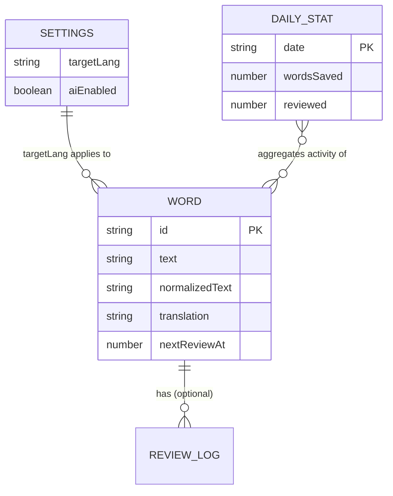

# DATA-SCHEMA

> **Audience:** developers (new members + AI coding assistants).
> **Source of truth in code:** each feature's `types.ts` (`src/features/<feature>/types.ts`), storage access in `src/features/<feature>/background/*.repo.ts`, shared helpers and migrations in `src/shared/storage/`.
> **Prerequisites:** [ARCHITECTURE.md](./ARCHITECTURE.md) · [PROJECT-RULES.md](./PROJECT-RULES.md)
> **Status:** v1 baseline. Items marked `⚠️ VERIFY` were inferred and must be confirmed against the codebase.

---

## 1. Overview

- **Local-first:** all user data lives on the device. No backend database.
- **Single writer:** only the service worker (via each feature's `*.repo.ts`) reads/writes storage. UI and content scripts use messages ([API-CONTRACTS.md](./API-CONTRACTS.md)).
- **Entities:** `Word`, `DailyStat`, `Settings`, `TranslationCacheEntry`, plus a `schemaVersion` meta record.



---

## 2. Storage Map

| Data | Area | Key pattern | Synced? | Notes |
|------|------|-------------|---------|-------|
| Schema version | `local` | `meta:schemaVersion` | No | Integer, drives migrations |
| Settings | `sync` ⚠️ VERIFY | `settings` | Yes | Small, must stay under sync quota |
| API key | `local` | `secret:aiApiKey` | **No** | Never sync, never log |
| Vocabulary | `local` | `vocab:{id}` | No | One key per word |
| Daily stats | `local` | `stats:{YYYY-MM-DD}` | No | One key per day |
| Translation cache | `session` | `cache:tr:{lang}:{normalizedText}` | No | TTL-based, safe to lose |

**Quotas (Chrome):**
- `storage.local`: ~10 MB by default. Add the `unlimitedStorage` permission only if needed. ⚠️ VERIFY
- `storage.sync`: ~100 KB total, 8 KB per item. Keep **only** small settings there.
- `storage.session`: in-memory, cleared when the browser closes.

> ⚠️ VERIFY: if vocabulary is stored in IndexedDB instead, keep the same entity shapes and replace key patterns with an object store `words` (keyPath `id`, index on `normalizedText` and `nextReviewAt`).

### 2.1 Entity ownership (feature-based)

Each entity is **owned by one feature**. Only the owner's `*.repo.ts` touches its keys. Other features go through the owner's public API.

| Entity / key | Owner feature | Types | Repo |
|--------------|---------------|-------|------|
| `Word` · `vocab:{id}`, `index:vocabByText` | `vocabulary` | `features/vocabulary/types.ts` | `vocabulary.repo.ts` |
| `DailyStat` · `stats:{date}` | `stats` | `features/stats/types.ts` | `stats.repo.ts` |
| `Settings` · `settings` | `settings` | `features/settings/types.ts` | `settings.repo.ts` |
| API key · `secret:aiApiKey` | `settings` (read by `summarize` via public API) | `features/settings/types.ts` | `settings.repo.ts` |
| Translation cache · `cache:tr:*` | `translate` | `features/translate/types.ts` | `translate.cache.ts` |
| `meta:schemaVersion`, migrations | shared | n/a | `shared/storage/` |

Cross-feature writes (examples):
- `vocabulary` saving a word calls `stats` public API: `recordEvent('wordsSaved')`.
- `flashcards` submitting a review calls `vocabulary` public API: `updateReviewState(wordId, result)`. SRS fields live on `Word` but are **updated only through** `vocabulary`.

---

## 3. Conventions

- **IDs:** `crypto.randomUUID()` (string). Never reuse.
- **Timestamps:** epoch **milliseconds** (`number`), e.g. `createdAt: 1760000000000`. ⚠️ VERIFY
- **Date keys:** local date string `YYYY-MM-DD` (user's timezone), used only for `DailyStat`.
- **Language codes:** BCP-47 short form: `'en'`, `'vi'`, `'ja'`.
- **Normalization (`normalizedText`):** `text.trim().toLowerCase()` with collapsed inner whitespace. Used for dedupe and lookup.
- **Optional fields:** use `?` and treat missing as "not set". Never store `null` unless it has meaning.
- **Immutability of IDs/keys:** never rename keys without a migration (see §8).

---

## 4. Entities

### 4.1 `Word` (vocabulary + flashcard state)

Owner: `features/vocabulary` · Key: `vocab:{id}`

```ts
interface Word {
  id: string                 // UUID
  text: string               // as selected by the user, e.g. 'Ubiquitous'
  normalizedText: string     // 'ubiquitous' (dedupe key)
  translation: string        // 'có mặt ở khắp nơi'
  phonetic?: string          // '/juːˈbɪkwɪtəs/'
  partOfSpeech?: string      // 'adjective'
  context?: string           // sentence where the word was found (max 500 chars)
  sourceUrl?: string         // page origin + path, no query/hash
  sourceLang: string         // 'en'
  targetLang: string         // 'vi'
  createdAt: number
  updatedAt: number

  // Spaced repetition state
  reviewCount: number        // total reviews, starts at 0
  lapseCount: number         // times rated 'again'
  srsStep: number            // index into SRS_LADDER_DAYS (0..4), new word = 0
  lastReviewedAt?: number
  nextReviewAt: number       // due when <= now; new words = createdAt
}
```

**Example**
```json
{
  "id": "6f1c0a52-8b3e-4d6a-9a1e-2a7f5c1d9b10",
  "text": "Ubiquitous",
  "normalizedText": "ubiquitous",
  "translation": "có mặt ở khắp nơi",
  "phonetic": "/juːˈbɪkwɪtəs/",
  "context": "Smartphones have become ubiquitous in modern life.",
  "sourceLang": "en",
  "targetLang": "vi",
  "createdAt": 1760000000000,
  "updatedAt": 1760000000000,
  "reviewCount": 0,
  "lapseCount": 0,
  "srsStep": 0,
  "nextReviewAt": 1760000000000
}
```

**Rules**
- Unique by `normalizedText` + `targetLang`. Saving a duplicate updates `context`/`updatedAt` instead of creating a new record.
- `translation` is required. Do not save a word without it.
- SRS uses a **fixed ladder** (beginner-friendly, decided in [PRD.md](./PRD.md) FR-07): `SRS_LADDER_DAYS = [1, 3, 7, 14, 30]`, defined in `features/flashcards/srs.ts`.
  - New word: `srsStep = 0`, due immediately.
  - `again` → `srsStep = 0`, `lapseCount + 1` (due in 1 day).
  - `good` → `srsStep = min(srsStep + 1, 4)`.
  - `easy` → `srsStep = min(srsStep + 2, 4)`.
  - `nextReviewAt = now + SRS_LADDER_DAYS[srsStep]` days.
  - The interval is **derived** from `srsStep`. Do not store it.
- The calculation is a pure, unit-tested function. The result is persisted through `vocabulary`'s public API.

### 4.2 `DailyStat`

Owner: `features/stats` · Key: `stats:{YYYY-MM-DD}`

```ts
interface DailyStat {
  date: string               // '2026-10-08'
  wordsLookedUp: number      // translations requested
  wordsSaved: number
  cardsReviewed: number
  correctCount: number       // rated 'good' or 'easy'
  summariesUsed: number      // AI summarization calls
}
```

**Example**
```json
{ "date": "2026-10-08", "wordsLookedUp": 42, "wordsSaved": 9, "cardsReviewed": 25, "correctCount": 21, "summariesUsed": 2 }
```

**Rules**
- Created lazily on first event of the day.
- Counters only increment. Derived values (accuracy, streak) are **computed**, not stored.
- Streak = consecutive days with `cardsReviewed > 0` (computed at read time).
- Retention: keep 365 days, prune older records with a daily `chrome.alarms` job. ⚠️ VERIFY

### 4.3 `Settings`

Owner: `features/settings` · Key: `settings` (area: `sync`)

```ts
interface Settings {
  sourceLang: string         // default 'en'
  targetLang: string         // default 'vi'
  uiLanguage: 'vi' | 'en'    // extension UI language, default 'vi'
  aiEnabled: boolean         // default false (opt-in)
  aiProvider?: 'openai' | 'anthropic' | 'custom'   // ⚠️ VERIFY providers
  tooltipTrigger: 'auto' | 'icon'   // show on select, or via small icon
  dailyGoal: number          // cards/day, default 10
  theme: 'system' | 'light' | 'dark'
}
```

**Defaults** live in `features/settings/constants.ts` (`DEFAULT_SETTINGS`). Always merge stored values over defaults so new fields get defaults after updates.

### 4.4 Secret: AI API key

Key: `secret:aiApiKey` (area: `local`) → `string`

- Never in `sync`, never in logs, never in exports/backups.
- Read only inside `features/summarize/background/summarize.client.ts` (via `settings` public API).

### 4.5 `TranslationCacheEntry` (ephemeral)

Owner: `features/translate` · Key: `cache:tr:{targetLang}:{normalizedText}` (area: `session`)

```ts
interface TranslationCacheEntry {
  translation: string
  phonetic?: string
  cachedAt: number
  ttlMs: number              // default 24h
}
```

- Safe to delete at any time. Never rely on it for correctness.

### 4.6 `ReviewLog` (optional) ⚠️ VERIFY

Only add if analytics per review are needed. Otherwise skip to keep storage small.

```ts
interface ReviewLog { wordId: string; reviewedAt: number; rating: Rating; prevIntervalDays: number }
type Rating = 'again' | 'good' | 'easy'
```

---

## 5. Access Patterns

| Use case | How |
|----------|-----|
| Get all words | `storage.local.get(null)` then filter keys by prefix `vocab:` (or maintain an index, see §6) |
| Find by text (dedupe) | Lookup via `vocabIndex` (`normalizedText` → `id`) |
| Due cards | Filter `nextReviewAt <= Date.now()`, sort ascending, limit by `dailyGoal` |
| Today's stats | `get('stats:' + todayKey)` |
| Last 7 days chart | `get` 7 known keys in one call |

---

## 6. Indexes (key-value store)

`chrome.storage` has no query engine, so keep light indexes in `local`. Indexes are owned by the feature that owns the entity (`vocabulary`):

| Key | Shape | Purpose |
|-----|-------|---------|
| `index:vocabByText` | `Record<string, string>` (`'{targetLang}:{normalizedText}'` → `id`) | O(1) dedupe lookup |

Rules:
- Update the index in the **same repository function** that writes a `Word` (use one `storage.local.set({...})` call so both writes are atomic).
- If the index is missing or corrupted, rebuild it by scanning `vocab:*` (`rebuildIndexes()` in repository).
- ⚠️ VERIFY: with large vocabularies (> ~5,000 words), consider moving to IndexedDB.

---

## 7. Validation & Integrity

- Validate at the **repository boundary** (before writing) and when **importing**. Suggested: `zod` ⚠️ VERIFY.
- Limits: `text` ≤ 100 chars, `translation` ≤ 500, `context` ≤ 500.
- Reject writes with unknown `targetLang` or empty `normalizedText`.
- On read, tolerate missing optional fields; never crash on unexpected data. Log a warning and skip the bad record.

---

## 8. Migrations

**Never lose user vocabulary on extension update.**

- Current version: `meta:schemaVersion = 1`.
- Run on `chrome.runtime.onInstalled` (reason `install` or `update`) **and** on service worker startup as a safety net.
- Migrations are ordered, idempotent functions in `src/shared/storage/migrations/` (one global `schemaVersion`).
- Migrations work on **raw stored data** and must **not import feature code** (shared must not depend on features). Define the minimal old shapes locally in each migration file.

```
shared/storage/migrations/
├── index.ts          # runMigrations(): reads version, applies pending steps
├── 001-initial.ts
└── 002-add-example-field.ts   # example future migration
```

```ts
interface Migration {
  version: number            // target version
  description: string
  up(): Promise<void>        // must be idempotent
}
```

**Process for a schema change**
1. Update types in the owning feature's `types.ts`.
2. Add migration `NNN-description.ts` and register it in `index.ts`.
3. Add a unit test with a sample "old" dataset.
4. Update this file (§4 and the changelog below) and [CHANGELOG.md](./CHANGELOG.md).
5. **Back up** before destructive steps: copy affected data under `backup:v{old}` and remove only after success.

**Rules**
- Additive changes (new optional field with default) are preferred.
- Renaming/removing keys requires a migration and one full release of backward compatibility.
- If a migration fails: stop, keep old data untouched, surface an error state, and do not bump `schemaVersion`.

---

## 9. Export / Import

- **Owner:** `features/settings` (data section of the options page). It collects data through each feature's public background API, never by reading keys directly.
- **Export format:** JSON file, downloaded from the options page.

```json
{
  "app": "english-reading-assistant",
  "schemaVersion": 1,
  "exportedAt": 1760000000000,
  "words": [ /* Word[] */ ],
  "stats": [ /* DailyStat[] */ ],
  "settings": { /* Settings */ }
}
```

- **Excluded:** API key and cache.
- **Import:** validate, then **merge** by `normalizedText + targetLang` (keep the newer `updatedAt`). Run migrations if the file's `schemaVersion` is older. Reject newer versions with a clear error.

---

## 10. Privacy & Retention

- Data never leaves the device except: selected text sent to the translation/AI API on explicit user action.
- `sourceUrl` strips query and hash to avoid saving tokens or personal data.
- "Reset all data" in options: removes `vocab:*`, `stats:*`, `index:*`, `cache:*`, keeps nothing except `meta:schemaVersion`. Requires confirmation.

---

## 11. Do / Don't

**Do**
- Add new fields as optional with defaults.
- Write entity + index in a single `set()` call.
- Keep SRS logic pure and inside `features/flashcards/`.

**Don't**
- Don't access `chrome.storage` outside `*.repo.ts` and `shared/storage/`.
- Don't write another feature's keys. Call the owner's public API.
- Don't store secrets in `sync`.
- Don't store derived values (accuracy, streak) that can be computed.
- Don't change key patterns without a migration.

---

## 12. Schema Changelog

| Version | Date | Change |
|---------|------|--------|
| 1 | 2026-10-08 | Baseline: `Word` (fixed-ladder SRS via `srsStep`), `DailyStat`, `Settings` (with `uiLanguage`, `dailyGoal` = 10), cache, index |

---

## 13. Open Questions

- [ ] Confirm storage backend for vocabulary (`chrome.storage.local` vs IndexedDB).
- [ ] Confirm actual field names in `shared/types.ts` (replace the assumed ones above).
- [x] SRS algorithm: fixed ladder `[1, 3, 7, 14, 30]` days (decided; product owner to confirm).
- [ ] Confirm timestamp format (epoch ms vs ISO string).
- [ ] Confirm AI provider list and whether `ReviewLog` is needed.
- [ ] Decide on stats retention period.
- [ ] Confirm ownership split: SRS fields on `Word` updated via `vocabulary` (current proposal) vs a separate `CardState` entity owned by `flashcards`.
